# claudepad

[](https://github.com/nwilsson/claudepad)
[](CHANGELOG.md)
[](https://github.com/nwilsson/claudepad/actions/workflows/check.yml)
[](LICENSE)

**A notepad pane for Claude Code: your notes sit next to the work, and Claude can read them too.**

<p>
  
  <br>
  <sub>An illustration drawn from the mod's own pane output, not a screen recording.</sub>
</p>

Ideas, follow-ups and TODOs pile up while Claude works, and the transcript is
a bad place to keep them. claudepad adds a notes pane inside Claude Code, in
the terminal or the desktop Code tab. Notes belong to the repo you are in, to
the branch you are on, or to you everywhere. Claude can park a follow-up
instead of derailing the task, tick off the TODOs it finishes, and keep your
pinned notes in mind on every prompt.

## Install

In Claude Code:

```
/plugin marketplace add nwilsson/claudepad
/plugin install claudepad@claudepad
```

Restart Claude Code, then run `/notes`.

Requires Claude Code 2.1.296 or later; older versions reject the hook API.
Git is optional: it is only used to read the current branch.

## Usage

Open the pane with `/notes`, or add a note without leaving the prompt:

```
/note fix the login redirect #bug
/note -g renew the domain #due:2026-11-01
/note -b ask in review whether the retry belongs here
```

Or ask Claude:

- *"Park that as a note, we'll come back to it."*
- *"What's on my notepad for this repo?"*
- *"Tick off the notes you finished in this session."*

### Notes where you work

- **Per repo, on every machine.** A repo's notes are filed under its git
  remote (`github.com/you/repo`), so they are the same in every clone and
  subfolder. A repo with no remote goes by its root folder; any other folder
  by itself.
- **Per branch.** `/note -b` (or **🌿** in the pane) ties a note to the
  current branch: it shows only while that branch is checked out. Once the
  branch is merged and deleted, its notes come back to the repo's list,
  marked **(gone)**.
- **Global.** `/note -g` notes follow you everywhere.

### Claude-aware

- **Pinned notes** ride along with every prompt as standing context. Past
  about 1k tokens, the pane and a toast tell you, so they don't quietly eat
  your context.
- **Tools for Claude:** `add_note`, `list_notes`, `complete_note` and
  `update_note`. Every change Claude makes shows a toast.
- **Due dates** (`#due:2026-10-20`) are flagged at session start and on the
  status line, and Claude is told which notes are overdue.
- **→ prompt** puts a note into the prompt box. `/note --last` saves
  Claude's last reply as a note.

### Keep it tidy

- **Tags:** `#words` are colored, counted and clickable in the tag bar.
- **Search:** every word must match; `#tag` matches a tag exactly.
- **Order:** pinned first, open before done, then your own order (**↑**/**↓**,
  or `u`/`n`), or **Sort: due**.
- **Archive, not delete:** finished notes go to an archive view, week by
  week, with undo. Deleting for good happens only there.
- **File links:** a `path:line` in a note gets an **open** button for VS
  Code, Cursor or a JetBrains IDE.

### Sync

- **`NOTES.md`:** `/notes export` writes the repo's notes to a Markdown
  file. From then on the file is followed: edit it in your editor, or let
  Claude or a `git pull` change it, and the notes follow within seconds. A
  deleted line archives its note, with undo.
- **A notes folder:** set the `notesFolder` option to a git-tracked or
  synced folder, and notes live there as one JSON file per project, one note
  per line, so two machines' changes merge cleanly.

## Reference

<details>
<summary><b>Commands</b></summary>

| Command | What it does |
| --- | --- |
| `/notes` | Open or close the pane |
| `/notes find <text>` | Search every note; `#tag` matches a tag |
| `/notes tags` | List your tags, most used first |
| `/notes export [--force]` | Write the repo's notes to `NOTES.md`; `--force` replaces a file you wrote |
| `/notes import [--replace]` | Read `NOTES.md` in; `--replace` makes the notes exactly the file's |
| `/notes undo` | Bring back the last archived notes |
| `/note <text>` | Add a note for this repo |
| `/note -g <text>` | Add a global note |
| `/note -b <text>` | Add a note for the current branch |
| `/note --last [text]` | Save Claude's last reply, with your text as its first line |
| `/note` | Open the multi-line editor |

</details>

<details>
<summary><b>Keys in the pane</b></summary>

With the pane focused (click it, or `ctrl+x tab`):

| Key | Action |
| --- | --- |
| `j` / `k` | Select the next or previous note |
| `d` | Mark the selected note done, or open again |
| `p` | Pin or unpin it |
| `u` / `n` | Move it up or down |

In the multi-line editor: arrows, `Home`/`End` and `PgUp`/`PgDn` move,
`Enter` starts a new line, `Ctrl+S` saves.

</details>

<details>
<summary><b>Claude's tools</b></summary>

| Tool | What Claude can do |
| --- | --- |
| `add_note` | Add a note for the repo, the current branch (`branch: true`) or global (`global: true`) |
| `list_notes` | Read the repo's and global notes, with ids, overdue marks and tags; or search every note |
| `complete_note` | Mark a note done, or open again (`done: false`) |
| `update_note` | Rewrite a note's text, for example to record progress |

</details>

<details>
<summary><b>Settings</b></summary>

Set these in `/config`, under claudepad.

| Option | Default | What it does |
| --- | --- | --- |
| `editor` | `vscode` | What a note's **open** button opens in: `vscode`, `cursor` or `jetbrains` |
| `notesFolder` | *(empty)* | A folder to keep notes in instead of the plugin store; absolute, or starting with `~/` |

</details>

## How it works

claudepad is a Claude Code mod: a hooks module that adds the pane, the
commands, the status line and Claude's tools. Notes are kept in the mod's own
store under your Claude Code config folder, or in your `notesFolder`, one file
per project. Every change reads the stored notes fresh before writing, so two
sessions open at once don't overwrite each other.

A repo is recognized by its origin remote, so notes follow it across clones
and machines. The current git branch is read when a session starts, before
each prompt, and after Claude runs a shell command.

## FAQ

### Where are my notes stored?

In Claude Code's plugin store, a JSON file under `~/.claude/plugins/store/`,
unless you set `notesFolder`. Either way they are plain JSON. `/notes export`
gives you a Markdown copy at any time.

### What gets sent to Claude?

Your pinned notes go with every prompt, and whatever Claude reads with
`list_notes`. Nothing else leaves your machine, except where your
`notesFolder` syncs to.

### Can I use it on two machines?

Yes: point `notesFolder` at a folder you sync or keep in git. Repo notes
match across machines by the repo's remote. If a git merge leaves a conflict
in a notes file, claudepad tells you and won't write over it until it's fixed.

### What happens to branch notes after a merge?

Once the branch is deleted, its notes rejoin the repo's list, marked
**(gone)**, so nothing is stranded. Move them to the whole repo, or archive
them.

### Does it cost context?

Only pinned notes are sent on every prompt, and the pane warns you past about
1k tokens. Everything else reaches Claude only when it asks for it.

## Feedback

Found a bug or want something? [Open an issue](https://github.com/nwilsson/claudepad/issues).

## For developers

<details>
<summary>Layout, tests and local development</summary>

Try it from a clone without installing:

```
claude --plugin-dir /path/to/claudepad
```

| Path | What's there |
| --- | --- |
| `.claude-plugin/plugin.json` | The manifest; `marketplace.json` lists it |
| `hooks/register.tsx` | Commands, the pane, tools, prompt context, storage, sync |
| `hooks/notes.ts` | The notes logic, with no engine or UI: tags, search, order, Markdown, merge |
| `hooks/editor.tsx` | The multi-line editor component |
| `types/index.d.ts` | The note and state types |
| `tests/` | Logic tests and engine tests with a mocked store, clock and folder |
| `ROADMAP.md` | What was built, and the decisions behind it |
| `scripts/demo/` | How `docs/demo.svg` is captured from the pane and built |

Checks:

```
claude plugin validate .
npx -p typescript tsc -p .   # after the engine has laid .claude-plugin/types
claude plugin test .         # tests/*.test.ts(x), in the engine's sandbox
```

`scripts/check.sh` runs all three and checks that both manifests carry the
same version. CI runs it on every push and pull request, without tsc: the
types only exist once the engine has loaded the plugin.

</details>

## License

[MIT](LICENSE)
